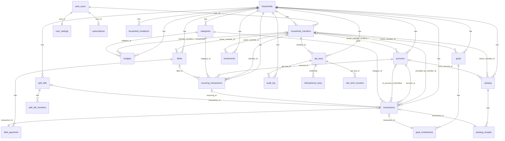

Status: draft
Terakhir diubah: 2026-10-07
Bergantung pada: 00-ringkasan.md, 01-kondisi-saat-ini.md

> **Riwayat perubahan**
> | Tanggal | Bagian | Perubahan | Alasan |
> |---|---|---|---|
> | 2026-10-07 | §3, §8.3 (implisit) | **F-D** (migrasi `00000000000023`): tabel `shopping_items`, `pantry_items` (lokasi, tanggal kedaluwarsa), `pantry_movements`; fungsi `apply_pantry_movement`, `find_pantry_match`/`find_shopping_match` (pencocokan longgar via `norm_text`+trgm, BUKAN pola `resolve_*` jsonb). Detail: `10-fitur-opsional-keluarga.md` §6. | Implementasi F-D. |
> | 2026-10-07 | — (apps/api) | **Bug nyata**: `current_date + ${jsNumber}` tanpa cast eksplisit di tagged template postgres.js -> `operator is not unique: date + unknown` (parameter tanpa tipe eksplisit ambigu antara overload `date+integer`/`date+interval`). Diperbaiki `${n}::int`. | Ditemukan test integrasi `GET /v1/pantry/expiring`. |
> | 2026-10-07 | §3, §8.3 (implisit) | **F-0+F-A** (migrasi `00000000000021`, `00000000000022`): `households.features jsonb`; tabel `beneficiaries` + `beneficiaries_kind` enum + `transactions.beneficiary_id`; `resolve_beneficiary()`, `enable_beneficiary_feature()`; `post_transaction` tambah parameter `p_beneficiary_id` (signature berubah, `drop function` dulu pola 0013/0014); `post_transactions_batch` dan `update_transaction` baca `beneficiary_id` dari jsonb yang sudah ada (signature TIDAK berubah). Detail lengkap di `10-fitur-opsional-keluarga.md` §2-§3. | Implementasi F-0/F-A, spec ditulis 2026-10-07. |
> | 2026-10-07 | — (apps/api, bukan SQL) | **Bug nyata ditemukan**: `${JSON.stringify(x)}::jsonb` di tagged template postgres.js men-DOBEL encode nilai yang sudah string (jadi jsonb STRING SCALAR, bukan OBJECT/ARRAY) — menimpa `post_transactions_batch` (tidak pernah ada test sebelumnya) dan kode baru `updateHousehold`. Diperbaiki pakai `tx.json(value)` (pola yang sudah benar di `routes/me.ts`). | Ditemukan test integrasi F-0 gagal 500 saat PATCH `/v1/households/current`; ditambah test regresi `/v1/transactions/batch`. |
> | 2026-10-04 | §7.3 api_keys | `REVOKE SELECT (key_hash)` (kolom) diganti `REVOKE SELECT` penuh pada tabel dasar + view `v_api_keys` tanpa `key_hash` | Supabase memberi `GRANT ALL` level-tabel ke `authenticated`/`anon` lewat `ALTER DEFAULT PRIVILEGES` platform; grant level-tabel mengalahkan revoke level-kolom, jadi pendekatan asli tidak benar-benar menyembunyikan `key_hash`. Ditemukan saat pengujian RLS terhadap DB nyata. |
> | 2026-10-04 | §4.1 `v_account_balances` | Tambah `case when can_view_account(a.id) then … else null end` pada `balance`/`tx_count`/`last_tx_date` | Pengujian RLS nyata menemukan view membocorkan `opening_balance` (angka salah dan menyesatkan) untuk akun privat milik member lain, meski RLS transaksi sendiri sudah benar menyembunyikan riwayat. |
> | 2026-10-04 | §8.3 `post_transaction`, `post_transfer` | Hapus pengecualian "role household `owner` boleh menulis ke akun privat siapa pun"; sekarang hanya `shared` atau pemilik akun yang boleh, tanpa kecuali | Bug logika: `owner` adalah peran admin household (kelola member/kategori/API key), bukan pembebasan dari visibilitas akun privat. Pengujian menunjukkan bug ini membuat error jatuh ke pesan RLS generik, bukan `forbidden_account` yang jelas. |
> | 2026-10-04 | §7.3 (RLS) | Tambah policy INSERT untuk `debt_payments`, `goal_contributions`, `piutang_receipts` (migrasi `0012_fix_audit_trail_insert_policies.sql`) | Tabel-tabel ini hanya punya policy SELECT; `pay_debt`/`topup_goal`/`receive_piutang` (bukan SECURITY DEFINER) gagal 42501 permission denied saat dipanggil sebagai role `authenticated` sungguhan lewat `apps/api` (Fase 3). Lolos di pengujian Fase 2 karena saat itu dites sebagai superuser `postgres`. |
> | 2026-10-04 | §3.4, §3.5, §3.9 (index unik & trgm) | `lower(unaccent(name))` → `lower(name)` di semua index | Postgres menolak `unaccent()` di index expression karena ditandai STABLE, bukan IMMUTABLE; wrapper IMMUTABLE kustom (`immutable_unaccent`) tetap gagal saat `CREATE INDEX` mengevaluasi `regdictionary` meski berhasil di SELECT biasa (kuirk resolusi search_path khusus index build). `unaccent()` tetap dipakai di `norm_text()` untuk resolusi nama agent (bukan index), di mana masalah ini tidak muncul. |
> | 2026-10-04 | §7.3 piutang | `lend_piutang()` tambah parameter opsional `p_opening_received`, `p_icon`, `p_color` (migrasi 0013, 0014) | `CreatePiutangBodySchema` butuh `opening_received` (sudah ada di schema awal tapi belum sampai ke fungsi SQL) dan `icon`/`color` (kolom sudah ada di tabel `piutang` sejak F2 tapi tidak pernah diekspos lewat fungsi create — ditemukan Fase 4 saat audit payload `PiutangView.jsx`, yang selalu mengirim icon/color custom) |
> | 2026-10-04 | §6, §7.3 households | `create_household()` diubah jadi `SECURITY DEFINER` + guard `p_user_id = auth.uid()` (migrasi 0016); tambah RLS policy `households_delete` untuk owner (migrasi 0015) | Bug nyata Fase 4: `households` tidak pernah punya policy INSERT, jadi onboarding (`POST /v1/households`) SELALU gagal 403 untuk setiap user baru sejak fungsi ini dibuat — baru ketahuan saat verifikasi manual end-to-end, bukan review kode. `households_delete` dibutuhkan untuk `DELETE /v1/me` (F4-T5). |
> | 2026-10-06 | §3.14 | Tabel `subscriptions` + fungsi `upsert_subscription` **dihapus total** (migrasi `00000000000020_drop_subscriptions.sql`) | Pemilik produk mengonfirmasi project tidak pernah punya pembayaran sungguhan. Detail: `docs/spec/PROGRESS.md` §"Pembatalan total subscription/Midtrans". |
> | 2026-10-04 | §3.9 user_settings | FK `user_settings_active_household_id_fkey` diubah dari NO ACTION ke `ON DELETE SET NULL` (migrasi 0017) | Bug nyata Fase 4: `create_household()` selalu mengisi `active_household_id` ke household baru, jadi `DELETE /v1/me` (yang menghapus household) selalu kena FK violation 23503 → 500 generik. Kehilangan household aktif bukan error — `HouseholdProvider.jsx` sudah fallback ke membership pertama yang tersisa saat `active_household_id` null. |
> | 2026-10-04 | §6, §7.3 (Fase 5) | `create_invitation`/`accept_invitation`/`remove_member`/`change_member_role`/`merge_household_into` jadi `SECURITY DEFINER`; `remove_member` guard diubah izinkan self-leave; `household_members_household_id_user_id_key` (unique constraint biasa) diganti partial unique index `where deleted_at is null`; tambah policy `members_update` dan `invitations_update` (migrasi 0018) | 6 bug nyata ditemukan lewat pengujian manual F5-T1 end-to-end (undang→terima→ubah profil→keluar→undang lagi→gabung mode merge): RLS default-deny untuk fungsi tulis lintas-keanggotaan (pola sama dengan `create_household` F4), rejoin setelah leave selalu 23505, update profil sendiri selalu 0 baris. Detail lengkap di PROGRESS.md bagian Fase 5. |
> | 2026-10-04 | §6 households.getMe / auth middleware | `getMe()` dan `resolveMembership()` (middleware) ditambah filter `h.deleted_at is null` saat JOIN households | Bug nyata: household yang sudah di-merge (`merge_household_into`) masih muncul sebagai membership aktif karena baris `household_members` lama tidak dihapus (memang tidak boleh, demi histori), hanya household induknya yang soft-delete — tanpa filter ini, resolusi household aktif bisa salah pilih household basi. |
> | 2026-10-04 | §6 households.updateHousehold | Query baca-ulang setelah UPDATE diekstrak jadi `selectCurrentHousehold(tx, householdId)` yang memakai `tx` yang SAMA dengan UPDATE-nya, bukan transaksi baru | Bug nyata: `updateHousehold` sebelumnya memanggil `getCurrentHousehold(actor)`, yang membuka koneksi/transaksi BARU dari pool — belum bisa melihat UPDATE yang belum commit di transaksi pertama, jadi response API selalu nilai lama meski DB sudah benar. Kemungkinan sudah ada sejak PATCH household pertama dibuat (Fase 3/4). |
> | 2026-10-04 | §7.3, §7.4, §3.19 (Fase 6) | `create_api_key`/`revoke_api_key`/`resolve_api_key`/`touch_api_key_last_used` (SECURITY DEFINER, migrasi 0019); `audit_log` tambah policy INSERT; `v_api_keys` diubah `security_invoker = off`; `household_members` tambah grant kolom sempit (`id, user_id, role, deleted_at`) ke `karaya_api` | 3 bug RLS/grant nyata ditemukan saat implementasi F6-T1: audit_log tidak punya policy INSERT sama sekali; `v_api_keys` dengan `security_invoker=on` (kesalahan desain F2) membuat SELECT selalu permission-denied walau key_hash sudah di-revoke dengan benar di tabel dasar; resolveApiKeyActor butuh baca household_members SEBELUM JWT context terbentuk (pola sama dengan lookup api_keys sendiri, §7.4). Detail lengkap di PROGRESS.md bagian Fase 6. |
> | 2026-10-04 | apps/api (implisit, bukan skema) | `${JSON.stringify(x)}::jsonb` di 4 lokasi (idempotency response cache ×2, `PATCH /v1/me/settings`, `PATCH /v1/transactions/{id}` via `update_transaction`) diganti `sql.json(x)`/`tx.json(x)` | Bug data nyata: pola itu menghasilkan jsonb GANDA-ENCODED (string berisi teks JSON, bukan objek) — `PATCH /v1/transactions/{id}` sejak Fase 3 selalu 200 OK tapi TIDAK PERNAH benar-benar mengubah data (p_patch->>'key' pada jsonb string selalu null), dan `has_api_key` di settings AI selalu salah. Detail lengkap di PROGRESS.md bagian Fase 6. |

> **Riwayat perubahan**
> | Tanggal | Bagian | Perubahan | Alasan |
> |---|---|---|---|
> | 2026-10-04 | pengantar, §8.4 | Kolom legacy dan trigger sinkronisasi tidak ada; DDL di bab ini diterapkan langsung | DB produksi dikosongkan atas permintaan pemilik produk (4 user, 1.393 transaksi, 13 tabel domain di-drop; `gold_prices` dipertahankan untuk karaya-api). Backup: `backups/pre-wipe-*.sql` (lokal, gitignored), skema di `docs/reference/legacy-schema-live-2026-10-04.sql`. |

# 03 — Database: ERD, DDL, Saldo, RLS, Fungsi Atomik

Semua DDL di bab ini diterapkan **langsung** ke DB yang kosong (ADR-19). Tidak ada kolom legacy. Urutan file migrasi ada di `08` Fase 2. Tabel `gold_prices` milik `karaya-api` sudah ada di schema `public` dan tidak boleh disentuh oleh migrasi mana pun.

## 1. ERD



## 2. Ekstensi dan enum

```sql
CREATE EXTENSION IF NOT EXISTS pgcrypto;     -- gen_random_uuid, digest
CREATE EXTENSION IF NOT EXISTS pg_trgm;      -- similarity() untuk resolusi nama
CREATE EXTENSION IF NOT EXISTS pg_cron;      -- run_due_recurrings harian (aktifkan via Dashboard → Extensions)
CREATE EXTENSION IF NOT EXISTS unaccent;     -- normalisasi nama

CREATE TYPE member_role      AS ENUM ('owner', 'member', 'viewer');
CREATE TYPE account_type     AS ENUM ('bank', 'ewallet', 'cash', 'crypto', 'investasi', 'tabungan');
CREATE TYPE account_visibility AS ENUM ('shared', 'private');
CREATE TYPE tx_type          AS ENUM ('income', 'expense', 'transfer');
CREATE TYPE tx_source        AS ENUM ('web', 'api_key', 'recurring', 'system', 'import', 'migration');
CREATE TYPE category_type    AS ENUM ('income', 'expense', 'both');
CREATE TYPE recurring_frequency AS ENUM ('daily', 'weekly', 'monthly', 'yearly');
CREATE TYPE api_key_scope    AS ENUM ('read', 'write', 'admin');
CREATE TYPE credential_type  AS ENUM ('jwt', 'api_key', 'system');
CREATE TYPE invitation_status AS ENUM ('pending', 'accepted', 'revoked', 'expired');
```

Alasan enum, bukan CHECK TEXT: enum membuat nilai tak valid gagal di DB dan muncul di OpenAPI sebagai `enum` lewat zod yang sama; `ALTER TYPE … ADD VALUE` cukup untuk menambah nilai.

## 3. DDL tabel

Konvensi: semua tabel punya `id UUID PK DEFAULT gen_random_uuid()`, `created_at TIMESTAMPTZ NOT NULL DEFAULT now()`, `updated_at TIMESTAMPTZ NOT NULL DEFAULT now()` (trigger `set_updated_at()`), dan untuk yang soft-delete, `deleted_at TIMESTAMPTZ`. `COMMENT ON` wajib untuk kolom yang maknanya tidak jelas dari nama.

### 3.1 `households`

```sql
CREATE TABLE households (
  id           UUID PRIMARY KEY DEFAULT gen_random_uuid(),
  name         TEXT NOT NULL CHECK (length(name) BETWEEN 1 AND 80),
  timezone     TEXT NOT NULL DEFAULT 'Asia/Jakarta',            -- divalidasi trigger validate_timezone, lihat catatan
  currency     TEXT NOT NULL DEFAULT 'IDR' CHECK (currency = 'IDR'),
  default_account_visibility account_visibility NOT NULL DEFAULT 'shared',
  owners_can_view_private_totals BOOLEAN NOT NULL DEFAULT false,
  merged_into_household_id UUID REFERENCES households(id),
  created_by   UUID REFERENCES auth.users(id) ON DELETE SET NULL,
  created_at   TIMESTAMPTZ NOT NULL DEFAULT now(),
  updated_at   TIMESTAMPTZ NOT NULL DEFAULT now(),
  deleted_at   TIMESTAMPTZ
);
COMMENT ON COLUMN households.timezone IS 'Zona waktu untuk evaluasi period (this_month, today) dan tanggal default transaksi.';
COMMENT ON COLUMN households.currency IS 'Hardcode IDR. Non-tujuan multi-currency; kolom ada agar tidak perlu migrasi struktural nanti.';
COMMENT ON COLUMN households.owners_can_view_private_totals IS 'Bila true, owner boleh melihat ringkasan (bukan rincian) member lain yang punya akun privat. Lihat Q-05.';
COMMENT ON COLUMN households.merged_into_household_id IS 'Terisi bila household ini digabung ke household lain saat accept undangan mode merge; baris ikut deleted_at.';
```

Catatan: CHECK dengan subquery tidak diizinkan Postgres, karena itu validasi `timezone` dilakukan trigger `validate_timezone()` yang `RAISE` kalau nilai `NOT IN (SELECT name FROM pg_timezone_names)`.

### 3.2 `household_members`

```sql
CREATE TABLE household_members (
  id            UUID PRIMARY KEY DEFAULT gen_random_uuid(),
  household_id  UUID NOT NULL REFERENCES households(id) ON DELETE CASCADE,
  user_id       UUID NOT NULL REFERENCES auth.users(id) ON DELETE CASCADE,
  display_name  TEXT NOT NULL CHECK (length(display_name) BETWEEN 1 AND 60),
  role          member_role NOT NULL DEFAULT 'member',
  aliases       TEXT[] NOT NULL DEFAULT '{}',
  color         TEXT NOT NULL DEFAULT '#6366f1',
  joined_at     TIMESTAMPTZ NOT NULL DEFAULT now(),
  created_at    TIMESTAMPTZ NOT NULL DEFAULT now(),
  updated_at    TIMESTAMPTZ NOT NULL DEFAULT now(),
  deleted_at    TIMESTAMPTZ,
  UNIQUE (household_id, user_id)
);
CREATE UNIQUE INDEX household_members_active_name_uq
  ON household_members (household_id, lower(display_name)) WHERE deleted_at IS NULL;
CREATE INDEX household_members_user_idx ON household_members (user_id) WHERE deleted_at IS NULL;
COMMENT ON COLUMN household_members.aliases IS 'Kata yang dipakai agent untuk merujuk member ini, mis. {istri,bunda,mama}. Dicocokkan case-insensitive.';
COMMENT ON COLUMN household_members.deleted_at IS 'Member keluar. Baris dipertahankan karena transactions.recorded_by_member_id merujuknya.';
```

Aturan: minimal satu `owner` aktif per household (ditegakkan oleh fungsi `remove_member` dan `change_member_role`, bukan constraint, karena constraint lintas baris tidak praktis).

### 3.3 `household_invitations`

```sql
CREATE TABLE household_invitations (
  id             UUID PRIMARY KEY DEFAULT gen_random_uuid(),
  household_id   UUID NOT NULL REFERENCES households(id) ON DELETE CASCADE,
  email          TEXT CHECK (email IS NULL OR email ~* '^[^@\s]+@[^@\s]+\.[^@\s]+$'),
  code           TEXT NOT NULL UNIQUE,            -- 8 karakter base32 tanpa O/0/I/1, mis. 'K7M3-PX9Q'
  role           member_role NOT NULL DEFAULT 'owner',
  display_name_suggestion TEXT,
  invited_by     UUID NOT NULL REFERENCES household_members(id),
  status         invitation_status NOT NULL DEFAULT 'pending',
  expires_at     TIMESTAMPTZ NOT NULL DEFAULT now() + interval '7 days',
  accepted_by    UUID REFERENCES household_members(id),
  accepted_at    TIMESTAMPTZ,
  created_at     TIMESTAMPTZ NOT NULL DEFAULT now(),
  updated_at     TIMESTAMPTZ NOT NULL DEFAULT now()
);
CREATE INDEX household_invitations_pending_idx ON household_invitations (household_id) WHERE status = 'pending';
COMMENT ON COLUMN household_invitations.email IS 'Opsional. Kalau diisi, hanya user dengan email ini yang bisa menerima; kalau NULL, siapa pun pemegang code.';
```

### 3.4 `accounts`

```sql
CREATE TABLE accounts (
  id               UUID PRIMARY KEY DEFAULT gen_random_uuid(),
  household_id     UUID NOT NULL REFERENCES households(id) ON DELETE CASCADE,
  owner_member_id  UUID REFERENCES household_members(id),      -- NULL = joint
  name             TEXT NOT NULL CHECK (length(name) BETWEEN 1 AND 60),
  aliases          TEXT[] NOT NULL DEFAULT '{}',
  type             account_type NOT NULL,
  visibility       account_visibility NOT NULL DEFAULT 'shared',
  opening_balance  BIGINT NOT NULL DEFAULT 0 CHECK (opening_balance BETWEEN 0 AND 100000000000),
  icon             TEXT NOT NULL DEFAULT '💰',
  color            TEXT NOT NULL DEFAULT '#6366f1',
  sort_order       INT  NOT NULL DEFAULT 0,
  needs_review     BOOLEAN NOT NULL DEFAULT false,
  created_at       TIMESTAMPTZ NOT NULL DEFAULT now(),
  updated_at       TIMESTAMPTZ NOT NULL DEFAULT now(),
  deleted_at       TIMESTAMPTZ,
  CONSTRAINT accounts_joint_must_be_shared CHECK (owner_member_id IS NOT NULL OR visibility = 'shared')
);
-- Dua akun boleh bernama sama kalau pemiliknya beda. Joint diwakili uuid_nil.
CREATE UNIQUE INDEX accounts_name_per_owner_uq
  ON accounts (household_id, coalesce(owner_member_id, '00000000-0000-0000-0000-000000000000'::uuid), lower(name))
  WHERE deleted_at IS NULL;
CREATE INDEX accounts_household_idx ON accounts (household_id) WHERE deleted_at IS NULL;
CREATE INDEX accounts_name_trgm_idx ON accounts USING gin (lower(name) gin_trgm_ops);
COMMENT ON COLUMN accounts.opening_balance IS 'Saldo sebelum transaksi pertama. Saldo berjalan = opening_balance + efek transaksi aktif (lihat v_account_balances).';
COMMENT ON COLUMN accounts.aliases IS 'Nama alternatif untuk resolusi agent, mis. {bca,bca suami,rekening gaji}.';
COMMENT ON COLUMN accounts.needs_review IS 'True untuk akun placeholder yang dibuat migrasi karena account_name lama tidak ditemukan.';
```

### 3.5 `categories`

```sql
CREATE TABLE categories (
  id            UUID PRIMARY KEY DEFAULT gen_random_uuid(),
  household_id  UUID NOT NULL REFERENCES households(id) ON DELETE CASCADE,
  name          TEXT NOT NULL CHECK (length(name) BETWEEN 1 AND 40),
  aliases       TEXT[] NOT NULL DEFAULT '{}',
  type          category_type NOT NULL DEFAULT 'expense',
  icon          TEXT NOT NULL DEFAULT '📦',
  color         TEXT NOT NULL DEFAULT '#6366f1',
  is_system     BOOLEAN NOT NULL DEFAULT false,
  system_key    TEXT,                       -- 'transfer' | 'balance_adjustment' | 'debt_payment' | 'goal_saving' | 'piutang' ; NULL untuk non-sistem
  sort_order    INT NOT NULL DEFAULT 0,
  created_at    TIMESTAMPTZ NOT NULL DEFAULT now(),
  updated_at    TIMESTAMPTZ NOT NULL DEFAULT now(),
  deleted_at    TIMESTAMPTZ,
  CONSTRAINT categories_system_key_consistency CHECK ((is_system AND system_key IS NOT NULL) OR (NOT is_system AND system_key IS NULL))
);
CREATE UNIQUE INDEX categories_name_uq ON categories (household_id, lower(name)) WHERE deleted_at IS NULL;
CREATE UNIQUE INDEX categories_system_key_uq ON categories (household_id, system_key) WHERE system_key IS NOT NULL;
CREATE INDEX categories_name_trgm_idx ON categories USING gin (lower(name) gin_trgm_ops);
```

Seed per household (fungsi `seed_household_categories(p_household_id)` dipanggil saat household dibuat dan saat migrasi):

| name | type | icon | is_system | system_key | aliases default |
|---|---|---|---|---|---|
| Makanan | expense | 🍔 | | | {makan, jajan, kuliner, minum, sayur, belanja dapur} |
| Transport | expense | 🚗 | | | {bensin, ojek, grab, gojek, parkir, tol} |
| Kos/Sewa | expense | 🏠 | | | {sewa, kontrakan, kos} |
| Hiburan | expense | 🎬 | | | {nonton, game, langganan} |
| Shopping | expense | 🛍️ | | | {belanja, baju} |
| Utilitas | expense | ⚡ | | | {listrik, air, internet, pulsa, wifi} |
| Kesehatan | expense | 💊 | | | {obat, dokter, rs} |
| Pendidikan | expense | 📚 | | | {sekolah, kursus, buku} |
| Donasi | expense | ❤️ | | | {sedekah, zakat, infak} |
| Lainnya | both | 📦 | | | {} |
| Gaji | income | 💰 | | | {gajian, salary} |
| Freelance | income | 💼 | | | {project, sampingan} |
| Bisnis | income | 📊 | | | {usaha, jualan} |
| Investasi | income | 📈 | | | {dividen, cuan} |
| Transfer | both | 🔄 | true | transfer | {} |
| Koreksi Saldo | both | ⚖️ | true | balance_adjustment | {} |
| Hutang & Cicilan | expense | 📋 | true | debt_payment | {cicilan, angsuran, hutang} |
| Tabungan & Goal | expense | 🎯 | true | goal_saving | {nabung, tabungan} |
| Piutang | both | 🤝 | true | piutang | {} |

Aturan: kategori sistem tidak bisa dihapus atau diubah `type`-nya, boleh di-rename dan diberi alias. Transaksi tipe `transfer` **wajib** `category_id` = kategori `system_key='transfer'` (ditegakkan `post_transfer`).

### 3.6 `transactions`

```sql
CREATE TABLE transactions (
  id                     UUID PRIMARY KEY DEFAULT gen_random_uuid(),
  household_id           UUID NOT NULL REFERENCES households(id) ON DELETE CASCADE,
  type                   tx_type NOT NULL,
  amount                 BIGINT NOT NULL CHECK (amount > 0 AND amount <= 100000000000),
  account_id             UUID NOT NULL REFERENCES accounts(id),
  to_account_id          UUID REFERENCES accounts(id),
  category_id            UUID NOT NULL REFERENCES categories(id),
  note                   TEXT NOT NULL DEFAULT '' CHECK (length(note) <= 500),
  date                   DATE NOT NULL,
  recorded_by_member_id  UUID NOT NULL REFERENCES household_members(id),
  source                 tx_source NOT NULL DEFAULT 'web',
  recurring_id           UUID REFERENCES recurring_transactions(id) ON DELETE SET NULL,  -- FK ditambahkan setelah tabel recurring dibuat (migrasi 08)
  created_at             TIMESTAMPTZ NOT NULL DEFAULT now(),
  updated_at             TIMESTAMPTZ NOT NULL DEFAULT now(),
  deleted_at             TIMESTAMPTZ,
  deleted_by_member_id   UUID REFERENCES household_members(id),
  CONSTRAINT tx_transfer_shape CHECK (
    (type = 'transfer' AND to_account_id IS NOT NULL AND to_account_id <> account_id)
    OR (type <> 'transfer' AND to_account_id IS NULL)
  )
);
CREATE INDEX tx_household_date_idx   ON transactions (household_id, date DESC, created_at DESC) WHERE deleted_at IS NULL;
CREATE INDEX tx_account_idx          ON transactions (account_id) WHERE deleted_at IS NULL;
CREATE INDEX tx_to_account_idx       ON transactions (to_account_id) WHERE deleted_at IS NULL AND to_account_id IS NOT NULL;
CREATE INDEX tx_category_idx         ON transactions (household_id, category_id, date) WHERE deleted_at IS NULL;
CREATE INDEX tx_recorded_by_idx      ON transactions (recorded_by_member_id, date) WHERE deleted_at IS NULL;
CREATE INDEX tx_note_trgm_idx        ON transactions USING gin (lower(note) gin_trgm_ops);
CREATE UNIQUE INDEX tx_recurring_once_per_date_uq ON transactions (recurring_id, date) WHERE recurring_id IS NOT NULL AND deleted_at IS NULL;
COMMENT ON COLUMN transactions.account_id IS 'Akun asal. Untuk income: akun yang menerima. Untuk expense/transfer: akun yang berkurang.';
COMMENT ON COLUMN transactions.recorded_by_member_id IS 'Siapa yang mencatat; bukan siapa pemilik uang (lihat accounts.owner_member_id).';
COMMENT ON COLUMN transactions.source IS 'Jalur pencatatan: web, api_key (agent), recurring, system (koreksi), import, migration.';
```

Pagination cursor memakai `(date DESC, created_at DESC, id DESC)`; index pertama mendukungnya.

### 3.7 `budgets`

```sql
CREATE TABLE budgets (
  id            UUID PRIMARY KEY DEFAULT gen_random_uuid(),
  household_id  UUID NOT NULL REFERENCES households(id) ON DELETE CASCADE,
  category_id   UUID NOT NULL REFERENCES categories(id),
  member_id     UUID REFERENCES household_members(id),   -- NULL = anggaran household
  period_start  DATE NOT NULL CHECK (period_start = date_trunc('month', period_start)::date),
  amount        BIGINT NOT NULL CHECK (amount > 0 AND amount <= 100000000000),
  created_at    TIMESTAMPTZ NOT NULL DEFAULT now(),
  updated_at    TIMESTAMPTZ NOT NULL DEFAULT now(),
  deleted_at    TIMESTAMPTZ
);
CREATE UNIQUE INDEX budgets_uq ON budgets (household_id, category_id, coalesce(member_id, '00000000-0000-0000-0000-000000000000'::uuid), period_start) WHERE deleted_at IS NULL;
CREATE INDEX budgets_period_idx ON budgets (household_id, period_start) WHERE deleted_at IS NULL;
COMMENT ON COLUMN budgets.period_start IS 'Tanggal 1 bulan anggaran. Periode = [period_start, period_start + 1 month).';
COMMENT ON COLUMN budgets.member_id IS 'NULL: anggaran keluarga, dihitung dari semua akun. Terisi: anggaran pribadi, dihitung dari akun milik member tsb (atribusi owner).';
```

Rasional `period_start DATE` dan bukan `daterange`: UI dan agent hanya mengenal bulan; `daterange` memperumit unique constraint dan query status. Kalau kelak butuh mingguan, tambah kolom `period_type` tanpa mengubah data lama.

### 3.8 `goals` + `goal_contributions`

```sql
CREATE TABLE goals (
  id               UUID PRIMARY KEY DEFAULT gen_random_uuid(),
  household_id     UUID NOT NULL REFERENCES households(id) ON DELETE CASCADE,
  owner_member_id  UUID REFERENCES household_members(id),   -- NULL = bersama
  name             TEXT NOT NULL CHECK (length(name) BETWEEN 1 AND 80),
  target           BIGINT NOT NULL CHECK (target > 0),
  opening_amount   BIGINT NOT NULL DEFAULT 0 CHECK (opening_amount >= 0),
  deadline         DATE,
  icon             TEXT NOT NULL DEFAULT '🎯',
  color            TEXT NOT NULL DEFAULT '#6366f1',
  created_at       TIMESTAMPTZ NOT NULL DEFAULT now(),
  updated_at       TIMESTAMPTZ NOT NULL DEFAULT now(),
  deleted_at       TIMESTAMPTZ
);
CREATE TABLE goal_contributions (
  id              UUID PRIMARY KEY DEFAULT gen_random_uuid(),
  goal_id         UUID NOT NULL REFERENCES goals(id) ON DELETE CASCADE,
  transaction_id  UUID UNIQUE REFERENCES transactions(id),  -- NULL = top-up tanpa potong akun
  member_id       UUID NOT NULL REFERENCES household_members(id),
  amount          BIGINT NOT NULL CHECK (amount <> 0),       -- negatif = penarikan (fase lanjut)
  date            DATE NOT NULL,
  note            TEXT NOT NULL DEFAULT '',
  created_at      TIMESTAMPTZ NOT NULL DEFAULT now()
);
CREATE INDEX goal_contributions_goal_idx ON goal_contributions (goal_id);
COMMENT ON COLUMN goals.opening_amount IS 'Nilai current lama saat migrasi, atau nilai awal yang diisi user saat membuat goal. current = opening_amount + Σ contributions aktif.';
```

### 3.9 `debts` + `debt_payments`

```sql
CREATE TABLE debts (
  id               UUID PRIMARY KEY DEFAULT gen_random_uuid(),
  household_id     UUID NOT NULL REFERENCES households(id) ON DELETE CASCADE,
  owner_member_id  UUID REFERENCES household_members(id),   -- NULL = hutang bersama (KPR)
  name             TEXT NOT NULL CHECK (length(name) BETWEEN 1 AND 80),
  aliases          TEXT[] NOT NULL DEFAULT '{}',
  total            BIGINT NOT NULL CHECK (total > 0),
  opening_paid     BIGINT NOT NULL DEFAULT 0 CHECK (opening_paid >= 0),
  monthly          BIGINT NOT NULL DEFAULT 0 CHECK (monthly >= 0),
  due_date         DATE,
  notes            TEXT NOT NULL DEFAULT '',
  icon             TEXT NOT NULL DEFAULT '📋',
  color            TEXT NOT NULL DEFAULT '#ef4444',
  created_at       TIMESTAMPTZ NOT NULL DEFAULT now(),
  updated_at       TIMESTAMPTZ NOT NULL DEFAULT now(),
  deleted_at       TIMESTAMPTZ
);
CREATE TABLE debt_payments (
  id              UUID PRIMARY KEY DEFAULT gen_random_uuid(),
  debt_id         UUID NOT NULL REFERENCES debts(id) ON DELETE CASCADE,
  transaction_id  UUID UNIQUE REFERENCES transactions(id),  -- NULL hanya untuk pembayaran tanpa akun (import manual)
  member_id       UUID NOT NULL REFERENCES household_members(id),
  amount          BIGINT NOT NULL CHECK (amount > 0),
  date            DATE NOT NULL,
  note            TEXT NOT NULL DEFAULT '',
  created_at      TIMESTAMPTZ NOT NULL DEFAULT now()
);
CREATE INDEX debt_payments_debt_idx ON debt_payments (debt_id);
COMMENT ON COLUMN debts.opening_paid IS 'total - remaining lama saat migrasi. remaining = total - opening_paid - Σ payments aktif, dibatasi >= 0.';
COMMENT ON COLUMN debts.aliases IS 'Untuk agent: {cicilan motor, motor, kredit motor}.';
```

### 3.10 `piutang` + `piutang_receipts`

```sql
CREATE TABLE piutang (
  id                UUID PRIMARY KEY DEFAULT gen_random_uuid(),
  household_id      UUID NOT NULL REFERENCES households(id) ON DELETE CASCADE,
  owner_member_id   UUID REFERENCES household_members(id),
  borrower_name     TEXT NOT NULL CHECK (length(borrower_name) BETWEEN 1 AND 80),
  total             BIGINT NOT NULL CHECK (total > 0),
  opening_received  BIGINT NOT NULL DEFAULT 0 CHECK (opening_received >= 0),
  from_account_id   UUID REFERENCES accounts(id),
  lend_transaction_id UUID UNIQUE REFERENCES transactions(id),  -- transaksi expense "Piutang" saat meminjamkan, kalau potong akun
  due_date          DATE,
  notes             TEXT NOT NULL DEFAULT '',
  icon              TEXT NOT NULL DEFAULT '🤝',
  color             TEXT NOT NULL DEFAULT '#60fcc6',
  created_at        TIMESTAMPTZ NOT NULL DEFAULT now(),
  updated_at        TIMESTAMPTZ NOT NULL DEFAULT now(),
  deleted_at        TIMESTAMPTZ
);
CREATE TABLE piutang_receipts (
  id              UUID PRIMARY KEY DEFAULT gen_random_uuid(),
  piutang_id      UUID NOT NULL REFERENCES piutang(id) ON DELETE CASCADE,
  transaction_id  UUID UNIQUE REFERENCES transactions(id),
  member_id       UUID NOT NULL REFERENCES household_members(id),
  amount          BIGINT NOT NULL CHECK (amount > 0),
  date            DATE NOT NULL,
  note            TEXT NOT NULL DEFAULT '',
  created_at      TIMESTAMPTZ NOT NULL DEFAULT now()
);
CREATE INDEX piutang_receipts_piutang_idx ON piutang_receipts (piutang_id);
```

### 3.11 `recurring_transactions`

```sql
CREATE TABLE recurring_transactions (
  id            UUID PRIMARY KEY DEFAULT gen_random_uuid(),
  household_id  UUID NOT NULL REFERENCES households(id) ON DELETE CASCADE,
  member_id     UUID NOT NULL REFERENCES household_members(id),  -- pembuat; dipakai sebagai recorded_by saat eksekusi
  name          TEXT NOT NULL CHECK (length(name) BETWEEN 1 AND 80),
  type          tx_type NOT NULL DEFAULT 'expense' CHECK (type <> 'transfer'),
  amount        BIGINT NOT NULL CHECK (amount > 0),
  category_id   UUID NOT NULL REFERENCES categories(id),
  account_id    UUID NOT NULL REFERENCES accounts(id),
  frequency     recurring_frequency NOT NULL,
  anchor_day    SMALLINT CHECK (anchor_day BETWEEN 1 AND 31),
  next_date     DATE NOT NULL,
  notes         TEXT NOT NULL DEFAULT '',
  debt_id       UUID REFERENCES debts(id) ON DELETE SET NULL,
  active        BOOLEAN NOT NULL DEFAULT true,
  last_run_at   TIMESTAMPTZ,
  last_error    TEXT,
  created_at    TIMESTAMPTZ NOT NULL DEFAULT now(),
  updated_at    TIMESTAMPTZ NOT NULL DEFAULT now(),
  deleted_at    TIMESTAMPTZ
);
CREATE INDEX recurring_due_idx ON recurring_transactions (next_date) WHERE active AND deleted_at IS NULL;
COMMENT ON COLUMN recurring_transactions.anchor_day IS 'Untuk monthly/yearly: tanggal target (mis. 31). next_date di-clamp ke hari terakhir bulan kalau bulan lebih pendek, lalu kembali ke anchor_day di bulan berikutnya. Diisi otomatis dari next_date awal.';
COMMENT ON COLUMN recurring_transactions.last_error IS 'Diisi run_due_recurrings bila eksekusi dilewati, mis. insufficient_funds. Dikosongkan saat berhasil.';
```

### 3.12 `split_bills`, `split_bill_members`

```sql
CREATE TABLE split_bills (
  id                   UUID PRIMARY KEY DEFAULT gen_random_uuid(),
  household_id         UUID NOT NULL REFERENCES households(id) ON DELETE CASCADE,
  created_by_member_id UUID NOT NULL REFERENCES household_members(id),
  title                TEXT NOT NULL,
  total_amount         BIGINT NOT NULL CHECK (total_amount > 0),
  date                 DATE NOT NULL,
  note                 TEXT NOT NULL DEFAULT '',
  transaction_id       UUID UNIQUE REFERENCES transactions(id),  -- opsional: transaksi expense yang dibayar dulu oleh member
  created_at           TIMESTAMPTZ NOT NULL DEFAULT now(),
  updated_at           TIMESTAMPTZ NOT NULL DEFAULT now(),
  deleted_at           TIMESTAMPTZ
);
CREATE TABLE split_bill_members (
  id          UUID PRIMARY KEY DEFAULT gen_random_uuid(),
  bill_id     UUID NOT NULL REFERENCES split_bills(id) ON DELETE CASCADE,
  name        TEXT NOT NULL,
  amount      BIGINT NOT NULL CHECK (amount > 0),
  paid_at     TIMESTAMPTZ,            -- menggantikan boolean paid
  created_at  TIMESTAMPTZ NOT NULL DEFAULT now()
);
```

### 3.13 `investments`

Sama dengan lama plus `household_id`, `owner_member_id` (NULL = bersama), `deleted_at`, `type` dibatasi CHECK `IN ('emas','saham','reksa_dana','crypto','properti','lainnya')`, `quantity NUMERIC(18,6)`.

### 3.14 `user_settings` (~~, `subscriptions`~~ dihapus 2026-10-06, lihat riwayat perubahan di atas)

Tidak berubah strukturnya (per `user_id`). Tambahan di `user_settings`: `active_household_id UUID REFERENCES households(id)` (household terakhir yang dipilih), `language TEXT`, `theme TEXT`. `ai_config` tetap JSONB; lihat Q-14 soal enkripsi.

Tabel `subscriptions` (dibuat migrasi `00000000000003`) dan fungsi `upsert_subscription` (migrasi `00000000000020`, dibuat lalu dihapus di sesi yang sama) **dihapus total** oleh migrasi `00000000000020_drop_subscriptions.sql` — project ini tidak pernah punya pembayaran sungguhan (konfirmasi pemilik produk 2026-10-06). Detail: `docs/spec/PROGRESS.md` §"Pembatalan total subscription/Midtrans".

### 3.15 `api_keys`

```sql
CREATE TABLE api_keys (
  id             UUID PRIMARY KEY DEFAULT gen_random_uuid(),
  household_id   UUID NOT NULL REFERENCES households(id) ON DELETE CASCADE,
  member_id      UUID NOT NULL REFERENCES household_members(id),
  name           TEXT NOT NULL CHECK (length(name) BETWEEN 1 AND 60),   -- "Hermes Telegram"
  key_prefix     TEXT NOT NULL,            -- 'kf_live_' + 8 char pertama dari random part, untuk lookup & tampilan
  key_hash       BYTEA NOT NULL UNIQUE,    -- sha256(pepper || full_key)
  scope          api_key_scope NOT NULL DEFAULT 'write',
  expires_at     TIMESTAMPTZ,              -- NULL = tidak kedaluwarsa
  last_used_at   TIMESTAMPTZ,
  last_used_ip   INET,
  revoked_at     TIMESTAMPTZ,
  created_by     UUID NOT NULL REFERENCES household_members(id),
  created_at     TIMESTAMPTZ NOT NULL DEFAULT now()
);
CREATE INDEX api_keys_prefix_idx ON api_keys (key_prefix) WHERE revoked_at IS NULL;
COMMENT ON TABLE api_keys IS 'Kunci jangka panjang untuk agent. Full key hanya dikembalikan sekali saat POST /v1/api-keys.';
```

Format key: `kf_live_` + 40 karakter base62 (≈238 bit entropi). `key_prefix` = `kf_live_` + 8 karakter pertama. Lookup: hash seluruh key → cocokkan `key_hash` (indeks unik); `key_prefix` hanya untuk tampilan di Settings dan pencocokan awal.

### 3.16 `idempotency_keys`

```sql
CREATE TABLE idempotency_keys (
  credential_type  credential_type NOT NULL,
  credential_id    UUID NOT NULL,            -- api_keys.id atau household_members.id (untuk jwt)
  key              TEXT NOT NULL CHECK (length(key) BETWEEN 1 AND 128),
  request_hash     BYTEA NOT NULL,           -- sha256(method || path || body kanonik)
  status           TEXT NOT NULL CHECK (status IN ('in_progress','completed')),
  response_status  INT,
  response_body    JSONB,
  created_at       TIMESTAMPTZ NOT NULL DEFAULT now(),
  expires_at       TIMESTAMPTZ NOT NULL DEFAULT now() + interval '24 hours',
  PRIMARY KEY (credential_type, credential_id, key)
);
CREATE INDEX idempotency_expires_idx ON idempotency_keys (expires_at);
```

Pembersihan: pg_cron harian `DELETE FROM idempotency_keys WHERE expires_at < now()`.

### 3.17 `rate_limit_counters`

```sql
CREATE TABLE rate_limit_counters (
  api_key_id    UUID NOT NULL REFERENCES api_keys(id) ON DELETE CASCADE,
  window_kind   TEXT NOT NULL CHECK (window_kind IN ('minute','day')),
  window_start  TIMESTAMPTZ NOT NULL,
  count         INT NOT NULL DEFAULT 0,
  PRIMARY KEY (api_key_id, window_kind, window_start)
);
```

Fungsi `bump_rate_limit(p_api_key_id, p_minute_limit, p_day_limit) RETURNS TABLE(allowed BOOLEAN, remaining_minute INT, remaining_day INT, reset_at TIMESTAMPTZ)` melakukan dua `INSERT … ON CONFLICT DO UPDATE SET count = count + 1 RETURNING count` dalam satu statement CTE. Pembersihan harian untuk `window_start < now() - interval '2 days'`.

### 3.18 `audit_log`

```sql
CREATE TABLE audit_log (
  id               BIGSERIAL PRIMARY KEY,
  household_id     UUID REFERENCES households(id) ON DELETE CASCADE,
  actor_member_id  UUID REFERENCES household_members(id),
  credential_type  credential_type NOT NULL,
  api_key_id       UUID REFERENCES api_keys(id) ON DELETE SET NULL,
  request_id       TEXT NOT NULL,
  idempotency_key  TEXT,
  action           TEXT NOT NULL,          -- 'transactions.create', 'transfers.create', 'accounts.delete', 'api_keys.revoke', 'error'
  resource_type    TEXT,
  resource_id      UUID,
  http_status      INT NOT NULL,
  payload          JSONB,                  -- body request setelah redaksi (tanpa key/secret), maks 8 KB
  ip               INET,
  user_agent       TEXT,
  created_at       TIMESTAMPTZ NOT NULL DEFAULT now()
);
CREATE INDEX audit_log_household_time_idx ON audit_log (household_id, created_at DESC);
CREATE INDEX audit_log_api_key_idx ON audit_log (api_key_id, created_at DESC) WHERE api_key_id IS NOT NULL;
```

Yang dicatat: **semua mutasi** (POST/PATCH/DELETE) lewat API key, dan mutasi sensitif lewat JWT (`api_keys.*`, `members.*`, `invitations.*`, `accounts.delete`, `households.*`). Mutasi transaksi biasa lewat JWT tidak dicatat (hemat ruang; `recorded_by` sudah menjawab siapa).

### 3.19 `migration_issues`

```sql
CREATE TABLE migration_issues (
  id          BIGSERIAL PRIMARY KEY,
  phase       TEXT NOT NULL,
  table_name  TEXT NOT NULL,
  row_id      UUID,
  issue       TEXT NOT NULL,     -- 'account_not_found', 'category_created', 'due_date_unparseable', 'negative_remaining'
  detail      JSONB,
  created_at  TIMESTAMPTZ NOT NULL DEFAULT now()
);
```

## 4. View

### 4.1 `v_account_balances` (inti ADR-05)

```sql
CREATE OR REPLACE VIEW v_account_balances AS
SELECT
  a.id AS account_id,
  a.household_id,
  a.opening_balance
    + COALESCE(SUM(CASE WHEN t.type = 'income'   AND t.account_id    = a.id THEN  t.amount END), 0)
    - COALESCE(SUM(CASE WHEN t.type = 'expense'  AND t.account_id    = a.id THEN  t.amount END), 0)
    - COALESCE(SUM(CASE WHEN t.type = 'transfer' AND t.account_id    = a.id THEN  t.amount END), 0)
    + COALESCE(SUM(CASE WHEN t.type = 'transfer' AND t.to_account_id = a.id THEN  t.amount END), 0)
    AS balance,
  COUNT(t.id) FILTER (WHERE t.id IS NOT NULL) AS tx_count,
  MAX(t.date) AS last_tx_date
FROM accounts a
LEFT JOIN transactions t
  ON t.deleted_at IS NULL AND (t.account_id = a.id OR t.to_account_id = a.id)
GROUP BY a.id;
```

Fungsi pendamping untuk dipakai di dalam fungsi atomik (tanpa join seluruh tabel):

```sql
CREATE FUNCTION account_balance(p_account_id UUID) RETURNS BIGINT
LANGUAGE sql STABLE AS $$
  SELECT a.opening_balance
    + COALESCE((SELECT SUM(amount) FROM transactions WHERE deleted_at IS NULL AND account_id    = a.id AND type = 'income'),   0)
    - COALESCE((SELECT SUM(amount) FROM transactions WHERE deleted_at IS NULL AND account_id    = a.id AND type IN ('expense','transfer')), 0)
    + COALESCE((SELECT SUM(amount) FROM transactions WHERE deleted_at IS NULL AND to_account_id = a.id AND type = 'transfer'), 0)
  FROM accounts a WHERE a.id = p_account_id;
$$;
```

### 4.2 `v_debts`, `v_piutang`, `v_goals`

```sql
CREATE VIEW v_debts AS
SELECT d.*,
  GREATEST(0, d.total - d.opening_paid - COALESCE((SELECT SUM(p.amount) FROM debt_payments p JOIN transactions t ON t.id = p.transaction_id WHERE p.debt_id = d.id AND t.deleted_at IS NULL), 0)
                                        - COALESCE((SELECT SUM(p.amount) FROM debt_payments p WHERE p.debt_id = d.id AND p.transaction_id IS NULL), 0)) AS remaining
FROM debts d;
-- v_piutang: remaining = total - opening_received - Σ receipts aktif
-- v_goals  : current   = opening_amount + Σ contributions aktif ; reached = current >= target
```

Pembayaran yang transaksinya di-soft-delete otomatis tidak dihitung. Ini mengganti perilaku lama yang "hapus transaksi cicilan tidak mengembalikan sisa hutang".

### 4.3 `v_transactions` (untuk API listing)

Join `transactions` dengan `accounts` (nama, owner, visibility), `to_account`, `categories` (nama, icon, color), `household_members` (recorded_by display_name), plus kolom turunan `owner_member_id` (dari akun asal) untuk atribusi. Hanya baris `deleted_at IS NULL`; versi `v_transactions_all` menyertakan yang terhapus untuk endpoint restore.

## 5. Keputusan saldo akun

**Pilihan: derived** (ADR-05). Trade-off yang diterima:

| Aspek | Derived (dipilih) | Stored + trigger (ditolak) |
|---|---|---|
| Konsistensi | Selalu benar by construction | Bergantung pada trigger menutup semua jalur (insert/update/delete/soft delete/restore/ubah akun) |
| Performa baca akun | Agregasi per akun; dengan `tx_account_idx` dan puluhan ribu baris: < 5 ms untuk semua akun household | O(1) |
| Validasi saldo cukup | `SELECT … FOR UPDATE` baris `accounts` lalu `account_balance()` dalam transaksi yang sama | Sama perlu lock |
| Soft delete / restore | Otomatis | Trigger tambahan |
| Rekonsiliasi | Tidak diperlukan; "Koreksi Saldo" tetap ada untuk mencocokkan dengan dunia nyata | Perlu job pembanding |
| Migrasi | `opening_balance = balance_lama − efek_transaksi_lama`, jadi angka yang dilihat user tidak berubah | Salin `balance` |

Konkurensi: semua fungsi yang mengurangi saldo mengambil `SELECT id FROM accounts WHERE id = ANY(p_ids) ORDER BY id FOR UPDATE` (urutan tetap mencegah deadlock pada transfer dua arah bersamaan), lalu menghitung `account_balance()`. Karena pooler transaction mode, lock hanya hidup selama satu fungsi.

Rekonsiliasi dengan dunia nyata: pengguna memakai `adjust_balance` (membuat transaksi Koreksi Saldo). Tidak ada rekonsiliasi internal karena tidak ada dua sumber angka.

Batas saldo negatif: dulu `CHECK balance >= 0`. Sekarang aturan `insufficient_funds` di fungsi. Karena `opening_balance >= 0` dan setiap pengurang divalidasi, saldo derived tidak bisa negatif kecuali lewat **restore** transaksi expense yang dihapus setelah saldo dipakai; `restore_transaction` memvalidasi saldo cukup juga.

## 6. Soft delete: dampak

| Entitas | Cara hapus | Dampak saldo | Dampak laporan | Pemulihan |
|---|---|---|---|---|
| `transactions` | `delete_transaction()` set `deleted_at`, `deleted_by_member_id` | Langsung hilang dari `v_account_balances` (saldo "kembali") | Hilang dari semua agregasi; `GET /v1/transactions?include_deleted=true` menampilkannya dengan flag | `restore_transaction()`; validasi saldo cukup bila expense/transfer |
| `debt_payments` dkk. | Tidak dihapus langsung; ikut status transaksinya | — | `remaining` naik kembali | ikut restore transaksi |
| `accounts` | `delete_account()`; ditolak bila `account_balance() <> 0` (`account_has_balance`) atau ada transaksi aktif (`account_has_transactions`) kecuali `p_force_archive = true` yang mengizinkan saldo 0 dengan transaksi | Tidak ada (saldo 0) | Transaksi lama tetap tampil dengan nama akun + label "(dihapus)" | `PATCH /v1/accounts/{id}` dengan `restore: true` (owner) |
| `household_members` | `remove_member(p_member_id, p_reassign_to_member_id)`; akun miliknya dipindah ke member lain atau joint (`NULL`); budget pribadi dihapus (soft); API key-nya dicabut | Tidak ada | `recorded_by` tetap menunjuk member terhapus; ditampilkan sebagai "(mantan anggota) Nama" | Undang ulang → member baru (bukan restore) |
| `categories` | Soft; ditolak bila `is_system` atau masih dipakai transaksi aktif (`category_in_use`) kecuali `p_merge_into_category_id` diberikan → transaksi/budget/recurring dipindahkan dulu | — | — | restore via PATCH |
| `goals`, `debts`, `piutang`, `recurring`, `split_bills`, `investments`, `budgets` | Soft | Tidak mengubah transaksi yang sudah ada | Hilang dari listing default | PATCH `restore: true` |
| `households` | Soft oleh owner terakhir; semua data ikut tersembunyi | | | Manual oleh operator |

Hard delete hanya terjadi lewat `DELETE /v1/me` (hapus `auth.users` → cascade) dan job pembersihan `idempotency_keys`, `rate_limit_counters`.

## 7. RLS

### 7.1 Model akses

- Backend terhubung sebagai role `karaya_api` (bukan superuser, bukan `service_role`), yang `GRANT authenticated TO karaya_api` sehingga bisa `SET LOCAL ROLE authenticated`.
- Per request: `BEGIN; SET LOCAL ROLE authenticated; SELECT set_config('request.jwt.claims', '{"sub":"<user_id>","role":"authenticated","kf_member_id":"<member_id>","kf_household_id":"<household_id>","kf_scope":"write"}', true); …; COMMIT`.
- Untuk API key, `sub` = `household_members.user_id` dari key tersebut. Jadi `auth.uid()` selalu user manusia yang bertanggung jawab.
- pg_cron memanggil fungsi `SECURITY DEFINER` (`run_due_recurrings`) sebagai `postgres`; fungsi itu memfilter sendiri per household.

### 7.2 Helper

```sql
CREATE FUNCTION current_member_ids() RETURNS SETOF UUID
LANGUAGE sql STABLE SECURITY DEFINER SET search_path = public AS $$
  SELECT id FROM household_members WHERE user_id = auth.uid() AND deleted_at IS NULL;
$$;

CREATE FUNCTION current_household_ids() RETURNS SETOF UUID
LANGUAGE sql STABLE SECURITY DEFINER SET search_path = public AS $$
  SELECT household_id FROM household_members WHERE user_id = auth.uid() AND deleted_at IS NULL;
$$;

CREATE FUNCTION is_household_member(p_household_id UUID) RETURNS BOOLEAN
LANGUAGE sql STABLE AS $$ SELECT p_household_id IN (SELECT current_household_ids()); $$;

CREATE FUNCTION member_role_in(p_household_id UUID) RETURNS member_role
LANGUAGE sql STABLE SECURITY DEFINER SET search_path = public AS $$
  SELECT role FROM household_members WHERE household_id = p_household_id AND user_id = auth.uid() AND deleted_at IS NULL LIMIT 1;
$$;

-- Akun yang boleh dilihat DETAILnya (saldo & transaksi) oleh user saat ini
CREATE FUNCTION can_view_account(p_account_id UUID) RETURNS BOOLEAN
LANGUAGE sql STABLE SECURITY DEFINER SET search_path = public AS $$
  SELECT EXISTS (
    SELECT 1 FROM accounts a
    WHERE a.id = p_account_id
      AND is_household_member(a.household_id)
      AND (a.visibility = 'shared' OR a.owner_member_id IN (SELECT current_member_ids()))
  );
$$;

-- Akun yang boleh ditulis (dipakai sebagai sumber/tujuan) oleh user saat ini
CREATE FUNCTION can_post_to_account(p_account_id UUID) RETURNS BOOLEAN
LANGUAGE sql STABLE SECURITY DEFINER SET search_path = public AS $$
  SELECT EXISTS (
    SELECT 1 FROM accounts a
    WHERE a.id = p_account_id AND a.deleted_at IS NULL
      AND member_role_in(a.household_id) IN ('owner','member')
      AND (a.visibility = 'shared' OR a.owner_member_id IN (SELECT current_member_ids()))
  );
$$;
```

`SECURITY DEFINER` dengan `search_path` terkunci dipakai agar helper tidak rekursif kena RLS `household_members`.

### 7.3 Policy

Pola untuk tabel domain umum (`categories`, `budgets`, `goals`, `debts`, `piutang`, `recurring_transactions`, `split_bills`, `investments`, dan anak-anaknya lewat join):

```sql
ALTER TABLE goals ENABLE ROW LEVEL SECURITY;
CREATE POLICY goals_select ON goals FOR SELECT USING (is_household_member(household_id));
CREATE POLICY goals_write  ON goals FOR ALL
  USING (is_household_member(household_id) AND member_role_in(household_id) IN ('owner','member'))
  WITH CHECK (is_household_member(household_id) AND member_role_in(household_id) IN ('owner','member'));
```

Pengecualian dengan aturan visibilitas:

```sql
-- accounts: semua member melihat baris (nama, owner, tipe) agar bisa jadi tujuan transfer;
-- saldo tidak ada di tabel, jadi tidak bocor. Saldo privat disaring di v_account_balances & API.
CREATE POLICY accounts_select ON accounts FOR SELECT USING (is_household_member(household_id));
CREATE POLICY accounts_insert ON accounts FOR INSERT WITH CHECK (member_role_in(household_id) IN ('owner','member'));
CREATE POLICY accounts_update ON accounts FOR UPDATE
  USING (member_role_in(household_id) = 'owner' OR owner_member_id IN (SELECT current_member_ids()));
-- delete: hanya lewat fungsi delete_account (soft); tidak ada policy DELETE

-- transactions: detail hanya untuk akun yang boleh dilihat
CREATE POLICY tx_select ON transactions FOR SELECT
  USING (is_household_member(household_id) AND (can_view_account(account_id) OR (to_account_id IS NOT NULL AND can_view_account(to_account_id))));
CREATE POLICY tx_insert ON transactions FOR INSERT
  WITH CHECK (can_post_to_account(account_id) AND (to_account_id IS NULL OR can_post_to_account(to_account_id) OR
              EXISTS (SELECT 1 FROM accounts a WHERE a.id = to_account_id AND a.deleted_at IS NULL AND is_household_member(a.household_id))));
CREATE POLICY tx_update ON transactions FOR UPDATE USING (can_post_to_account(account_id));

-- v_account_balances dibuat dengan security_invoker = on agar RLS accounts/transactions berlaku:
ALTER VIEW v_account_balances SET (security_invoker = on);
```

Catatan transfer ke akun privat milik orang lain: **diizinkan sebagai tujuan** (kamu boleh mentransfer ke BCA istri yang privat), tetapi kamu tidak bisa melihat saldonya. Policy `tx_select` membuat pengirim tetap melihat transaksi transfer itu karena `can_view_account(account_id)` (akun asal) true.

Tabel infrastruktur:

| Tabel | SELECT | INSERT/UPDATE/DELETE |
|---|---|---|
| `households` | member | UPDATE owner; INSERT lewat fungsi `create_household` |
| `household_members` | member household yang sama | hanya lewat fungsi (`accept_invitation`, `remove_member`, `change_member_role`, `update_member_profile`) |
| `household_invitations` | owner household; **plus** siapa pun untuk baris yang `code` cocok lewat fungsi `preview_invitation(code)` SECURITY DEFINER | owner |
| `api_keys` | lewat view `v_api_keys` (tanpa `key_hash`); tabel dasar `REVOKE SELECT … FROM authenticated` penuh | owner, atau member untuk key miliknya sendiri |
| `audit_log` | owner household | hanya `karaya_api` langsung (sebelum SET ROLE) |
| `idempotency_keys`, `rate_limit_counters`, `migration_issues` | tidak ada untuk `authenticated`; hanya `karaya_api` | sama |
| `user_settings`, `subscriptions` | `auth.uid() = user_id` (tetap) | `user_settings` own; `subscriptions` hanya service role/internal |

### 7.4 Role database

```sql
CREATE ROLE karaya_api LOGIN PASSWORD '<dari secret manager>' NOINHERIT;
GRANT authenticated TO karaya_api;                 -- untuk SET LOCAL ROLE authenticated
GRANT USAGE ON SCHEMA public TO karaya_api;
GRANT SELECT, INSERT, UPDATE, DELETE ON idempotency_keys, rate_limit_counters, audit_log, migration_issues TO karaya_api;
GRANT SELECT ON api_keys TO karaya_api;            -- lookup hash sebelum SET ROLE
GRANT UPDATE (last_used_at, last_used_ip) ON api_keys TO karaya_api;
GRANT EXECUTE ON FUNCTION bump_rate_limit TO karaya_api;
```

Verifikasi API key dilakukan **sebelum** `SET LOCAL ROLE authenticated` (sebagai `karaya_api`), lalu klaim di-set. Dengan begitu kolom `key_hash` tidak pernah bisa dibaca oleh role `authenticated` (akses baca untuk endpoint `/v1/api-keys` lewat view `v_api_keys` yang tidak menyertakan `key_hash` sama sekali, bukan lewat revoke kolom — lihat catatan 2026-10-04 di atas).

## 8. Fungsi atomik (plpgsql)

### 8.1 Konvensi error

Semua fungsi melempar `RAISE EXCEPTION USING ERRCODE = 'P0001', MESSAGE = '<error_code>', DETAIL = '<json>'`, dengan `error_code` dari daftar di `05-api.md` §7 dan `DETAIL` berisi konteks (`{"account_id":..,"balance":..,"needed":..}`). `apps/api/src/db/errors.ts` memetakan `MESSAGE` → HTTP status + pesan Indonesia. Fungsi tidak pernah mengembalikan `{error}`; sukses mengembalikan baris atau JSONB.

Setiap fungsi mutasi menerima `p_actor_member_id` dan **memverifikasi** bahwa member itu aktif di household terkait dan `auth.uid()` (dari klaim) = `user_id` member tersebut (`actor_mismatch` bila tidak). Ini mencegah API memanggil atas nama member lain.

### 8.2 Daftar fungsi

| Fungsi | Signature (ringkas) | Return |
|---|---|---|
| `create_household` | `(p_name TEXT, p_timezone TEXT, p_display_name TEXT, p_user_id UUID)` | `households` + member owner (JSONB) |
| `create_invitation` | `(p_household_id, p_actor_member_id, p_email TEXT, p_role member_role, p_display_name_suggestion TEXT)` | `household_invitations` |
| `preview_invitation` | `(p_code TEXT)` SECURITY DEFINER | JSONB `{household_name, inviter_name, role, email_locked}` |
| `accept_invitation` | `(p_code TEXT, p_user_id UUID, p_display_name TEXT, p_mode TEXT)` — `p_mode IN ('fresh','merge')` | `household_members` |
| `remove_member` | `(p_household_id, p_actor_member_id, p_member_id, p_reassign_to_member_id UUID NULL)` | void |
| `merge_household_into` | `(p_source_household_id, p_target_household_id, p_member_id)` — dipanggil `accept_invitation` saat `p_mode='merge'`; aturan di `05-api.md` §5 | JSONB `{moved:{accounts, transactions, …}, categories_merged}` |
| `change_member_role` | `(p_household_id, p_actor_member_id, p_member_id, p_role)` | `household_members` |
| `post_transaction` | `(p_household_id, p_actor_member_id, p_type tx_type, p_account_id, p_category_id, p_amount BIGINT, p_date DATE, p_note TEXT, p_source tx_source, p_recurring_id UUID NULL)` | `transactions` |
| `post_transactions_batch` | `(p_household_id, p_actor_member_id, p_account_id, p_date DATE, p_items JSONB, p_source)` — items `[{category_id, amount, note}]` | `SETOF transactions` |
| `post_transfer` | `(p_household_id, p_actor_member_id, p_from_account_id, p_to_account_id, p_amount, p_date, p_note, p_source)` | `transactions` |
| `update_transaction` | `(p_household_id, p_actor_member_id, p_id, p_patch JSONB)` — patch boleh `amount, type, account_id, category_id, date, note`; untuk transfer hanya `date, note` | `transactions` |
| `delete_transaction` | `(p_household_id, p_actor_member_id, p_id)` | `transactions` (terhapus) |
| `restore_transaction` | `(p_household_id, p_actor_member_id, p_id)` | `transactions` |
| `adjust_balance` | `(p_household_id, p_actor_member_id, p_account_id, p_new_balance BIGINT, p_date DATE NULL, p_note TEXT NULL)` | JSONB `{account, transaction|null, diff}` |
| `pay_debt` | `(p_household_id, p_actor_member_id, p_debt_id, p_account_id, p_amount, p_date, p_note)` | JSONB `{transaction, payment, debt(v_debts)}` |
| `topup_goal` | `(p_household_id, p_actor_member_id, p_goal_id, p_account_id UUID NULL, p_amount, p_date, p_note)` | JSONB `{transaction|null, contribution, goal(v_goals), reached}` |
| `lend_piutang` | `(p_household_id, p_actor_member_id, p_borrower_name, p_total, p_from_account_id UUID NULL, p_owner_member_id UUID NULL, p_due_date DATE, p_notes, p_date)` | JSONB `{piutang, transaction|null}` |
| `receive_piutang` | `(p_household_id, p_actor_member_id, p_piutang_id, p_account_id, p_amount, p_date, p_note)` | JSONB `{transaction, receipt, piutang(v_piutang)}` |
| `delete_account` | `(p_household_id, p_actor_member_id, p_account_id, p_force_archive BOOLEAN DEFAULT false)` | `accounts` |
| `delete_category` | `(p_household_id, p_actor_member_id, p_category_id, p_merge_into_category_id UUID NULL)` | `categories` |
| `run_due_recurrings` | `(p_household_id UUID NULL, p_today DATE NULL)` SECURITY DEFINER | JSONB `{executed, skipped:[{recurring_id, reason}]}` |
| `bump_rate_limit` | lihat §3.17 | tabel |
| `resolve_account` | `(p_household_id, p_actor_member_id, p_query TEXT, p_prefer_own BOOLEAN DEFAULT false)` STABLE | JSONB `{status:'ok'|'ambiguous'|'not_found', account_id?, candidates:[{id,name,owner_display_name,owner_member_id,visibility,score}]}` |
| `resolve_category` | `(p_household_id, p_query TEXT, p_type tx_type NULL)` STABLE | JSONB serupa |
| `resolve_member` | `(p_household_id, p_query TEXT)` STABLE | JSONB serupa |
| `seed_household_categories` | `(p_household_id)` | void |
| `next_recurring_date` | `(p_from DATE, p_freq recurring_frequency, p_anchor_day SMALLINT)` IMMUTABLE | DATE |

### 8.3 Aturan validasi per fungsi

**`post_transaction`**
1. `p_amount > 0` dan `<= 100e9` (`validation_error`).
2. Actor aktif dan cocok `auth.uid()` (`actor_mismatch`, `not_household_member`).
3. Akun ada, `deleted_at IS NULL`, di household yang sama (`account_not_found`); `can_post_to_account` (`forbidden_account`).
4. Kategori ada di household, tidak terhapus (`category_not_found`); tipe kategori kompatibel: `income` butuh kategori `income|both`, `expense` butuh `expense|both` (`category_type_mismatch`). Kategori sistem `transfer` ditolak di sini (`category_reserved`).
5. `p_type <> 'transfer'` (`use_post_transfer`).
6. Jika `expense`: `SELECT … FOR UPDATE` akun; `account_balance() >= p_amount` (`insufficient_funds`, DETAIL `{balance, needed, account_name}`).
7. Insert; `note` default = nama kategori bila kosong.

**`post_transactions_batch`**: validasi 1–5 per item, lalu satu lock akun dan satu cek `balance >= Σ amount` (`insufficient_funds` dengan `{balance, needed: total}`). Semua atau tidak sama sekali. Maks 100 item (`batch_too_large`).

**`post_transfer`**
1. `from <> to` (`same_account_transfer`).
2. Keduanya di household sama, aktif. `can_post_to_account(from)`; untuk `to` cukup member household (boleh privat milik orang lain).
3. Lock kedua akun dengan urutan `ORDER BY id`.
4. `balance(from) >= amount` (`insufficient_funds`).
5. `category_id` = kategori sistem `transfer`. Note default `Transfer <from> → <to>`.

**`update_transaction`**
1. Transaksi ada, aktif, di household (`transaction_not_found`).
2. Jika `type='transfer'`: hanya `date`, `note` (`transfer_edit_limited`, hint: hapus lalu buat baru).
3. `type` baru tidak boleh `transfer` dan lama tidak boleh berubah dari/ke transfer.
4. Hitung ulang: lock akun lama dan baru; saldo setelah perubahan harus `>= 0` untuk setiap akun yang terdampak (`insufficient_funds`).
5. Kategori kompatibel dengan tipe baru.
6. `recurring_id` tidak bisa diubah.

**`delete_transaction`**: set `deleted_at`, `deleted_by_member_id`. Jika `income` (atau transfer masuk) dan penghapusan membuat saldo akun < 0 → ditolak (`would_make_balance_negative`) kecuali actor mengirim `p_allow_negative`—**tidak** ada parameter itu di v1; saldo negatif tidak boleh. Hapus transaksi yang terkait `debt_payments`/`goal_contributions`/`piutang_receipts` diizinkan (sisa hutang/goal/piutang otomatis dihitung ulang). Hapus transaksi `lend_transaction_id` piutang diizinkan dan menolkan `piutang.from_account_id`-nya (dicatat di note).

**`restore_transaction`**: kebalikan; untuk `expense`/`transfer` validasi saldo cukup (`insufficient_funds`). Jika `recurring_id` dan sudah ada transaksi aktif untuk `(recurring_id, date)` → `duplicate_recurring_execution`.

**`adjust_balance`**: lock akun; `diff = p_new_balance - account_balance()`; `diff = 0` → tidak ada transaksi; `diff > 0` → `income`, `< 0` → `expense`, kategori sistem `balance_adjustment`, `source='system'`, `date = coalesce(p_date, today_in_tz(household))`. `p_new_balance BETWEEN 0 AND 100e9`.

**`pay_debt`**: hutang ada, aktif (`debt_not_found`); `remaining > 0` (`debt_already_settled`); `amount <= remaining` kecuali `p_allow_overpay` (default false → `overpayment`, DETAIL `{remaining}`); `post_transaction(expense, kategori sistem debt_payment, note default 'Cicilan <nama>')`; insert `debt_payments`.

**`topup_goal`**: goal aktif (`goal_not_found`); jika `p_account_id` ada → `post_transaction(expense, kategori goal_saving, note 'Tabungan: <nama>')`; insert `goal_contributions`; `reached = current >= target`.

**`lend_piutang`**: jika `from_account_id` → `post_transaction(expense, kategori piutang, note 'Piutang ke <borrower>')`, simpan `lend_transaction_id`. `owner_member_id` default = actor.

**`receive_piutang`**: piutang aktif; `remaining > 0` (`piutang_already_settled`); `amount <= remaining` kecuali overpay; `post_transaction(income, kategori piutang, note 'Terima piutang dari <borrower>')`; insert `piutang_receipts`.

**`delete_account`**: lihat §6. Tambahan: akun yang masih dipakai `recurring_transactions` aktif → `account_in_use_by_recurring` (hint: ubah akun recurring dulu).

**`run_due_recurrings`**: untuk setiap recurring `active AND deleted_at IS NULL AND next_date <= today` (today dihitung per household timezone bila `p_today` NULL), loop **per baris dalam sub-blok `BEGIN … EXCEPTION`** supaya satu kegagalan tidak membatalkan yang lain:
1. Jika sudah ada transaksi aktif `(recurring_id, next_date)` → lewati, tetap majukan `next_date`.
2. `post_transaction(type, account_id, category_id, amount, next_date, note = name, source='recurring', recurring_id)` dengan actor = `member_id` pembuat (fungsi ini SECURITY DEFINER dan men-set klaim sementara via `set_config` ke user pembuat agar RLS dan `actor_mismatch` tetap konsisten).
3. Jika `debt_id` → insert `debt_payments`.
4. Sukses: `next_date = next_recurring_date(next_date, frequency, anchor_day)`, `last_run_at = now()`, `last_error = NULL`. Jika `next_date` yang baru masih `<= today` (tertinggal berhari-hari), ulangi langkah 1–4 maksimal 31 kali (catch-up), kecuali `frequency='daily'` yang hanya catch-up 7 hari.
5. Gagal (`insufficient_funds`, dll.): `last_error = SQLERRM`, **tidak** memajukan `next_date`, lanjut ke baris berikutnya. Dicatat juga di `audit_log` dengan `credential_type='system'`.

`next_recurring_date`: `daily` +1 hari; `weekly` +7; `monthly`: `date_trunc('month', from) + 1 month`, hari = `LEAST(anchor_day, hari_terakhir_bulan)`; `yearly`: tahun +1 dengan clamp 29 Feb → 28 Feb.

**`resolve_account`** (detail algoritma di `06-agent-integration.md` §4): normalisasi `lower(unaccent(trim))`, pecah token; token yang cocok `household_members.aliases`/`display_name`/kata `saya|aku|gue` (= actor) menjadi filter owner; `bersama|joint|keluarga|rumah` → filter joint; sisa token digabung sebagai nama. Skor: 100 exact name/alias dengan owner cocok; 90 exact tanpa owner filter; 70 prefix; 60 `similarity() >= 0.45`. `status='ok'` bila tepat satu kandidat berskor tertinggi; `'ambiguous'` bila > 1 pada skor yang sama (atau selisih < 10); `'not_found'` bila tidak ada ≥ 60. Akun yang tidak boleh dilihat actor tetap muncul sebagai kandidat tujuan transfer **tanpa** saldo.

### 8.4 Trigger

| Trigger | Tabel | Fungsi |
|---|---|---|
| `set_updated_at` | semua tabel ber-`updated_at` | `updated_at = now()` |
| `validate_timezone` | households | cek `pg_timezone_names` |
| `accounts_private_requires_owner` | accounts | sudah CHECK; trigger tambahan menolak mengubah `owner_member_id` ke NULL kalau `visibility='private'` |
| `tx_same_household` | transactions | akun, to_account, kategori, recorded_by harus `household_id` sama (FK tidak bisa menjamin ini) |
| `recurring_fill_anchor_day` | recurring_transactions | `anchor_day = extract(day from next_date)` bila NULL |

## 9. Index ringkas untuk query utama

| Query | Index |
|---|---|
| Listing transaksi household terbaru dengan cursor | `tx_household_date_idx` |
| Saldo per akun | `tx_account_idx`, `tx_to_account_idx` |
| Summary per kategori per periode | `tx_category_idx` |
| Pengeluaran per member (recorded_by) | `tx_recorded_by_idx`; per owner lewat join `accounts` (kecil) |
| Pencarian teks catatan | `tx_note_trgm_idx` |
| Resolusi nama | `accounts_name_trgm_idx`, `categories_name_trgm_idx` |
| Recurring jatuh tempo | `recurring_due_idx` |
| Lookup API key | `api_keys.key_hash` unique |

## 10. pg_cron

```sql
SELECT cron.schedule('run-due-recurrings', '5 17 * * *',   -- 00:05 WIB = 17:05 UTC
  $$SELECT run_due_recurrings(NULL, NULL)$$);
SELECT cron.schedule('cleanup-idempotency', '15 17 * * *',
  $$DELETE FROM idempotency_keys WHERE expires_at < now()$$);
SELECT cron.schedule('cleanup-rate-limits', '20 17 * * *',
  $$DELETE FROM rate_limit_counters WHERE window_start < now() - interval '2 days'$$);
SELECT cron.schedule('expire-invitations', '25 17 * * *',
  $$UPDATE household_invitations SET status='expired' WHERE status='pending' AND expires_at < now()$$);
```

Catatan: jadwal dalam UTC; `run_due_recurrings` menghitung `today` per household timezone, jadi household di luar WIB tetap benar meski jam eksekusinya bukan tengah malam lokal.

## 11. Periode dan zona waktu

Fungsi SQL `today_in_tz(p_household_id) RETURNS DATE` = `(now() AT TIME ZONE households.timezone)::date`. Semua default tanggal (`adjust_balance`, `run_due_recurrings`, `pay_debt` tanpa `p_date`) memakainya. Parser `period` ada di `apps/api/src/services/period.ts` dan menghasilkan `[from, to]` DATE inklusif dalam timezone household; SQL hanya menerima DATE.

## 12. Pemetaan masalah struktural → solusi

| # | Solusi di bab ini |
|---|---|
| 1 | §3.6 `account_id`, `to_account_id` FK; §3.4 unique per owner |
| 2 | §2 enum `tx_type` dengan `transfer`; §3.6 `tx_transfer_shape` |
| 3 | §3.5 `categories` per household + FK dari transactions, budgets, recurring |
| 4 | §3.7 `period_start DATE`; §3.9–3.10 `due_date DATE`; §3.8 `deadline DATE` |
| 5 | §5 saldo derived; §8 fungsi atomik dengan lock |
| 6 | (di `05-api.md`) semua akses lewat service layer |
| 7–8 | (di `05-api.md`) |
| 9 | §3.1–3.4 households, members, owner, visibility; §7 RLS |
